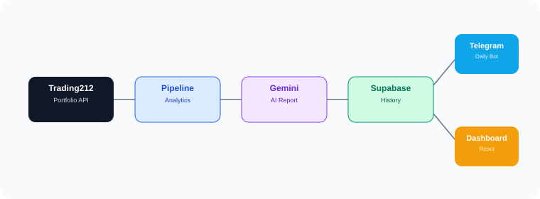

[](https://github.com/yhuang060122/Telegram212/actions/workflows/ci.yml)
[](https://github.com/yhuang060122/Telegram212/actions/workflows/daily_report.yml)
[](https://github.com/yhuang060122/Telegram212/actions/workflows/market_close.yml)
[](https://github.com/yhuang060122/Telegram212/actions/workflows/deploy-pages.yml)

# Trading212 AI Analyst

An AI-assisted investment analytics platform built with Trading212, Python, Gemini, Supabase, Telegram, GitHub Actions, FastAPI, Cloudflare Workers, and a React dashboard.

> Project status: Python pipeline, portfolio analytics, persistence, Telegram notifications, CI/tests, and the initial dashboard/API integration are in place. The remaining work is to validate live API data end-to-end, tighten API access control, and finish dashboard integration. See [HANDOFF.md](HANDOFF.md) for the current implementation status and risks.

## Overview

The system is designed to:

1. Read portfolio and account data from Trading212.
2. Calculate portfolio performance, risk, and allocation metrics.
3. Collect company news, earnings events, and macroeconomic indicators.
4. Generate structured AI investment analysis with Gemini.
5. Persist snapshots, holdings, research data, and reports in Supabase.
6. Send daily and market-close messages to Telegram.
7. Expose stored data through a read-only FastAPI API hosted on Cloudflare Workers.
8. Display analytics through a React dashboard using TanStack Query.

## Architecture



### Responsibilities

| Component | Responsibility |
|---|---|
| GitHub Actions | Schedule and run the daily-report and market-close pipelines; run CI checks |
| Python domain and services | Own portfolio models, analytics, research, and application logic |
| Supabase | Store portfolio snapshots, positions, research data, and reports |
| FastAPI + Cloudflare Workers | Expose read-only HTTP endpoints; reuse the existing `app/api/` routes |
| React dashboard | Query the API and present data with loading, error, and refresh states |
| Telegram | Deliver scheduled reports and interactive portfolio information |

The API is intended to read persisted data, not trigger a complete collection and AI-analysis pipeline on every dashboard request. The React application should access data through the API rather than connect directly to Supabase with privileged credentials.

## Current Status

| Area | Status |
|---|---|
| Phase 1 — Domain model | Completed |
| Phase 2 — Portfolio analytics | Completed |
| Phase 3 — Data quality and idempotency | Completed |
| Phase 4 — CI and tests | Completed; test suite has been fixed according to the current project state |
| Scheduled pipelines | Daily report and market-close workflows are present |
| Telegram bot and logging | Implemented |
| Dashboard | Phase 5.1–5.4 reported complete; verify each page against the current branch |
| FastAPI API | Routes are defined under `app/api/` |
| Cloudflare Python Worker | Deployed and running normally (confirmed by project owner); focus on real API data and end-to-end dashboard validation |
| End-to-end API → dashboard verification | Remaining validation |

Coverage is enforced by the current pytest configuration in `pyproject.toml` (minimum 80%). The coverage badge is intentionally not hard-coded here because a static badge can become stale; use the latest CI run and coverage artifact as the source of truth.

## Repository Layout

```text
Telegram212/
├── app/
│   ├── api/                 # FastAPI app and read-only API routes
│   ├── domain/              # Portfolio, positions, analytics, reports, research models
│   ├── infrastructure/      # Trading212, Supabase, Finnhub, FRED adapters
│   ├── services/            # Portfolio, analytics, research, AI analysis services
│   ├── telegram/            # Telegram handlers, formatting, and bot integration
│   ├── pipeline.py          # Pipeline orchestration
│   └── logger.py            # Application logging
├── api_worker/              # Thin Cloudflare ASGI adapter; reuses app/api/main.py
├── dashboard/               # React + TypeScript dashboard
├── prompts/                 # AI analyst prompts
├── tests/                   # pytest suite
├── .github/workflows/
│   ├── ci.yml
│   ├── daily_report.yml
│   ├── market_close.yml
│   ├── deploy-api-worker.yml
│   └── deploy-pages.yml
├── main.py
├── close.py
├── pyproject.toml
└── requirements.txt
```

This is a high-level guide; check the repository tree for the exact files in the current branch.

## Portfolio Analytics

The Python analytics layer covers portfolio-level performance, risk, and allocation metrics. The configured tests and implementation are the source of truth for each metric.

| Category | Examples |
|---|---|
| Performance | Daily and total return, TWR, XIRR |
| Risk | Drawdown, maximum drawdown, volatility, Sharpe ratio |
| Allocation | Position weights, sector allocation, concentration and HHI |
| Portfolio state | Total value, cash ratio, unrealized return |

Keep metric calculations in Python services. Do not reproduce business calculations independently in dashboard components.

## Research and AI Analysis

The research layer combines portfolio context with external information:

- **News:** Finnhub company news.
- **Earnings:** Finnhub earnings calendar.
- **Macro:** Federal Reserve Economic Data (FRED).
- **AI analysis:** Gemini, producing a structured report for storage and Telegram delivery.

External collectors are expected to report status and degrade gracefully where the business rules allow it. A failed optional research source should not silently erase otherwise valid portfolio history. A missing AI report should be handled explicitly rather than treated as a valid empty report.

## Supabase Storage

Supabase PostgreSQL is the persistent store for portfolio and research history. The current schema and repository implementation determine the exact columns and constraints.

The API should use the existing Repository/Service layer instead of creating a second database access implementation. Never expose the Supabase Service Role Key in browser code or a `VITE_*` variable.

## Telegram Commands

The bot supports interactive portfolio and analysis operations. Current command handlers and Telegram setup are authoritative; the table below lists the user-facing command concepts.

| Command | Purpose |
|---|---|
| `/daily` | Daily portfolio and AI summary |
| `/portfolio` | Current portfolio and holdings |
| `/stock NVDA` | Analysis of a held stock |
| `/risk` | Portfolio risk summary |
| `/history NVDA` | Historical data for a position |
| `/help` | Show supported commands |

Exact command aliases and arguments are defined by the Telegram router/handlers in the source code.

## API and Cloudflare Worker

The canonical FastAPI application is under `app/api/`. The `api_worker/` directory should remain a thin Cloudflare runtime adapter and deployment configuration layer; it should not implement a second set of business routes.

The health endpoint is:

```http
GET /api/health
```

Other supported endpoints must be verified against the actual FastAPI route registration or OpenAPI schema before they are used by dashboard hooks. In particular, do not assume that `/api/report/latest` exists just because it appeared in an earlier plan.

### API deployment checklist

- [ ] Smoke-test `/api/health` after deployment.
- [ ] Test each dashboard endpoint against live Supabase-backed data.
- [ ] Verify response schemas and query parameters against the actual routes.
- [ ] Configure required CORS origins.
- [ ] Add authentication/authorization before exposing personal investment data publicly.
- [ ] Confirm secrets are configured server-side and never included in frontend bundles.

The project owner has confirmed that the Worker is deployed and running normally. Remaining checks focus on actual endpoint contracts, live database-backed responses, API access control, and dashboard integration. Runtime/dependency compatibility is not a current blocker; re-test it if the Worker entry point, dependencies, or packaging configuration changes.

## Dashboard

The dashboard is a React/TypeScript application using the current project stack, including TanStack Query for remote data state. The intended data flow is:

```text
Dashboard page
  -> TanStack Query hook
  -> shared API client
  -> Cloudflare Worker / FastAPI
  -> existing Repository and Service
  -> Supabase
```

When connecting or extending a page, preserve loading, error, retry/refresh, and data-updated states. Replace mock data only after checking the actual API response contract. Do not put privileged backend keys in the dashboard.

## Scheduled Workflows and CI

The workflows are maintained in `.github/workflows/`:

- `ci.yml`: Python 3.12, Ruff, pytest, and coverage report.
- `daily_report.yml`: scheduled daily portfolio analysis/report.
- `market_close.yml`: market-close snapshot/review.
- `deploy-pages.yml`: dashboard deployment to GitHub Pages.
- `deploy-api-worker.yml`: Cloudflare Python Worker validation and deployment; requires `CLOUDFLARE_API_TOKEN` and `CLOUDFLARE_ACCOUNT_ID` repository secrets.

Check the Actions page for the latest run status rather than inferring current success from the presence of a workflow file.

### Required secrets

Configure only the secrets used by each workflow, in GitHub repository Actions secrets:

```text
SUPABASE_URL
SUPABASE_SERVICE_KEY
T212_API_KEY
T212_API_SECRET
GEMINI_API_KEY
TG_BOT_TOKEN
TG_CHAT_ID
FINNHUB_API_KEY
FRED_API_KEY
```

Telegram forum topic IDs and optional logging flags may also be required by the current workflow configuration. Check the workflow YAML for the exact names. Never commit secret values.

## Local Development

Python 3.12 or the version specified by `pyproject.toml` is recommended.

Create and activate a virtual environment, then install the project dependencies:

```powershell
python -m venv .venv
.\.venv\Scripts\Activate.ps1
python -m pip install --upgrade pip
pip install -r requirements.txt
```

Configure the required environment variables in a local `.env` file or through your shell. Do not commit `.env`.

Run quality checks:

```powershell
ruff check .
pytest
```

The project pytest configuration enables coverage reporting and enforces the configured minimum. A failure below the threshold should be treated as a CI failure, not ignored.

For dashboard work, use Bun as the package manager and follow the lockfile in `dashboard/`. Do not mix npm, pnpm, and Bun lockfiles. Ensure local Node/Bun versions satisfy the Vite toolchain requirements.

## Development Roadmap

### Immediate priorities

1. Validate the actual API response contracts against live data, then complete endpoint smoke tests.
2. Verify dashboard Query hooks use the real API paths and response shapes.
3. Complete the Overview page's end-to-end API integration, including loading/error/refresh states.
4. Add API authentication/authorization and verify CORS for the GitHub Pages and Lovable preview origins.
5. Add smoke tests for deployed API routes and dashboard data loading.

### Later improvements

- Pipeline run history and health/freshness indicators.
- Additional drift and rebalancing analytics.
- Further AI analysis improvements.
- Paper-trading capabilities, only after the read-only analytics system is stable and validated.

Live order placement or auto-trading should not be enabled without explicit safeguards, testing, and user confirmation.

## Trading212 API Reference

The upstream Trading212 API provides account, metadata, orders, positions, and historical data endpoints. This repository currently uses the parts required for portfolio read/analytics workflows; consult the official Trading212 API documentation for exact live endpoint and authentication behavior before extending the client.

## Project Handoff

For current architecture decisions, verified/unverified status, known pitfalls, and the detailed next-step checklist, see [HANDOFF.md](HANDOFF.md).
